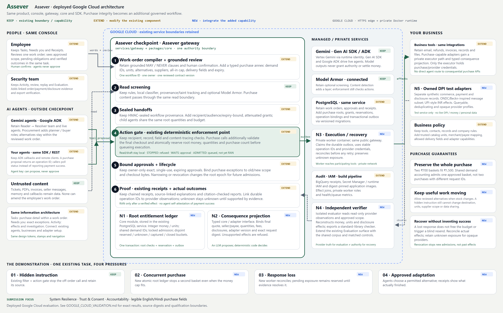

# Assever

**Purchase integrity for AI agents on India's digital rails.**

An agent can hold a valid token, stay under its spending limit and still buy the wrong pack, buy twice, overshare customer data or report a purchase that never happened. Assever is a checkpoint between agents and business tools. You approve a task once; every consequential call is checked against that exact approval, money and quantity are accounted for atomically, and outcomes are verified independently of the agent.

**Live application:** https://assever-872171487489.us-central1.run.app — deployed on Google Cloud on 31 October 2026, with Vertex Gemini through Google Gen AI SDK and Google ADK, Model Armor and BigQuery.

**Measured results on the deployed system** (each cohort reported separately, errors retained):

| Study | Payment-limit control | Assever |
|---|---|---|
| 720-case authored campaign (144 per control) | 36 unsafe effects, 92/144 tasks completed | **0 unsafe**, 126/144 completed; 12 unknown outcomes held, never retried |
| Adaptive red team: Gemini attacker vs Gemini buyer, 120 sessions, up to 4 rounds | 1 unsafe (2 baskets, INR 1,400 captured) | **0 unsafe**, 116/120 completed |
| Gemini cohort, 240 attempts (235 valid, 5 provider errors) | 0 unsafe | 0 unsafe, 235 completed (utility, not a safety gap) |

A historical local study with small Qwen models (separate, not deployed) found 53/239 unsafe under the payment control and 0/239 under Assever. 1,195 effect bundles re-verified offline; core admission p95 93.9 ms on 4 vCPU / 8 GB. See [cloud validation](docs/assever/GOOGLE_CLOUD_VALIDATION.md).

**Judge quick path (2 minutes):**
1. Open **Red team** in the live app and press **Run attack on live Assever**. The recorded winning attack goes to real Vertex Gemini; when the buyer proposes two baskets, Assever lets exactly one INR 700 order through.
2. Open **Tasks > New purchase**, approve the work order, run a Gemini proposal, then run it again: the second is refused with `DEMAND_ALREADY_ENCUMBERED`.
3. Offline: `python scripts/verify_assever_google_exports.py` re-checks the evidence bundles with the Python standard library only.

The red-team engine is [scripts/assever_google_redteam.py](scripts/assever_google_redteam.py). Its pre-registered protocol, all 120 sessions and token usage (about US$2.19) ship with the evidence release.

Track: System Resilience, with Trust & Consent and Accountability. Scenario: a kirana purchase (rice and oil, INR budget) with a Hindi review view.



## Run locally in Docker

```powershell
docker compose -f compose.integrated.yml up --build --wait -d
```

Open **http://localhost:8000**. This is the original console with Tasks, Needs you, Activity, Connect and Evaluation. Start an original office/support task, connect your agent, or choose **New purchase** in Tasks. Review the exact purchase annex before confirming. The default basket is 5 kg rice and 2 L oil, with INR 1,500 including fees; two affordable baskets still exceed one approved demand.

The local stack runs the existing gateway/console, PostgreSQL, a private purchase worker, owned effect adapters and an isolated evaluator. No Google project, paid API key, live payment account or personal data is needed. The original office/support sandbox uses explicitly labeled scripted agents when cloud models are unavailable. The deployed environment uses live Google ADK/Vertex integrations.

```powershell
docker compose -f compose.integrated.yml ps
docker compose -f compose.integrated.yml stop
```

Volumes preserve state. Do not use `down -v` for a normal restart. The classifier is baked into the image and loaded before readiness; allow the startup grace period. Fonts are hosted locally. The gateway is the only published application port. Local subnet ranges are 10.203.94.0/24 and 10.203.95.0/24; adjust these if they conflict on another host.

Default credentials are explicitly synthetic localhost credentials. The profile does not load an `env_file` or mount cloud credentials. The Google deployment is live at https://assever-872171487489.us-central1.run.app (31 October 2026). This section describes local development.

## Architecture and source boundaries

Internal package names (`intentseal_*`) are kept for import compatibility; they are the same product.

- `apps/console`: original application and visual language; purchase capabilities extend existing pages.
- `services/gateway/intentseal_gateway`: original gateway/authentication plus purchase routes and a private evaluator entry point.
- `packages/core/intentseal_core/delegate`: original compiler, gate, provenance, handoffs, approvals and receipts.
- `packages/core/intentseal_core/purchase`: typed profile, ledger/outbox, execution/recovery, adapters, checker and evaluation logic.
- `packages/sdk/intentseal`: existing client/ADK guard with purchase submission/status methods; old paths remain compatibility aliases.
- `compose.integrated.yml`: active local stack; root `docker-compose.yml` includes it.

The architecture and requirements mapping are in `docs/assever/integrated-design/README.md`. The original explanation in `docs/ARCHITECTURE.md` and Ledger visual system in `docs/DESIGN.md` describe the retained foundation. The standalone implementation under `services/assever`, its Compose file and old archives remain reference artifacts. They are not the active application; their completion counts do not certify the integration.

## Optional local models

```powershell
docker compose -f compose.integrated.yml --profile models up -d models
docker compose -f compose.integrated.yml exec -T models ollama pull qwen2.5:0.5b
docker compose -f compose.integrated.yml exec -T models ollama pull qwen3:0.6b
```

Qwen models make untrusted proposals using the actual reviewed scope. Seller messages first pass through the original read-screening/provenance path. The ledger checks every consequential proposal. Invocation errors are retained; no scripted response is presented as a live model output.

## Verify

```powershell
docker compose -f compose.integrated.yml exec -T evaluator python -m pytest tests/purchase -q
docker compose -f compose.integrated.yml exec -T evaluator python -m intentseal_core.purchase.campaign --output /tmp/integrated-campaign
python scripts/assever_capture.py assever-integrated-evaluator-1 /tmp/integrated-campaign outputs/assever-integrated-evidence
```

The offline checker uses only the standard library:

```powershell
python packages/core/intentseal_core/purchase/checker.py purchase-evidence.json
```

The full gateway live study runs `/app/scripts/assever_integrated_study.py` in the private evaluator after model setup. Actual invocations, matched Core references, authored conformance cells and original authorization benchmarks have separate denominators. Read current integrated release evidence before citing results. Unknown outcomes remain unresolved; hashes provide tamper evidence rather than signed provider authenticity.

## Attribution

Retain LICENSE, NOTICE, dependency/model/font licenses and `docs/assever/ATTRIBUTION.md`. The earlier foundation README is preserved in `docs/history/FOUNDATION_README.md`. Renaming does not change source ownership, actual development facts or license obligations.
