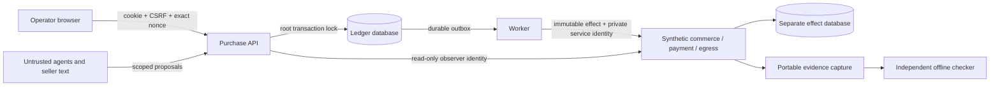

# Assever implementation and trust boundaries

The submitted local product runs FastAPI, a durable worker, PostgreSQL, an independent synthetic effect service, and a React console. The new purchase runtime is in `services/assever`. Historical authorization packages remain compatibility/reference code; they are not exposed by the Assever purchase server.

Ledger and effect stores use separate PostgreSQL roles/databases. Agents have no database, provider, callback, observer or issuer credential. Human session tokens are HttpOnly SameSite=Strict cookies; mutations also require a CSRF token. The localhost stack deliberately uses HTTP, so secure cookies are disabled there. This configuration is local-only. Its synthetic service/issuer defaults are documented, not production secrets. A shared installation requires different keys and authenticated enrollment before publication.

## Transaction boundaries

The root row lock serializes approvals, epoch changes, admissions, cancellation and settlement. Prepare creates only an immutable preview. Commit locks the root, rereads the operation, verifies the preview, checks current authority and quote freshness, reserves money/units/count and writes the outbox in one transaction. Repeated commits for the same stored operation do not create a second reservation.

All quantities use integer grams or millilitres. Money is integer paise. Reservation buckets are disjoint: reserved, unknown, captured, closed. A reservation moves buckets; it is never copied into another bucket. New proposal IDs, workers and agent grants retain the same server-created demand IDs and root capacity. Grants are HMAC-bound to a versioned issuer, recipient, audience, epoch, lines, operations and expiry. Child grants attenuate the parent and retain shared root accounting. This release implements shared grants, not independently spendable child wallets.

Workers durably mark DISPATCHING before sending. Stable provider IDs and generation fences bind the send to stored bytes. Claimed operations are never blindly redispatched. Expired claims are reconciled. A negative or unavailable lookup retains exposure. A terminal no-effect closure or fenced unsent cancellation can release exposure. Eight unsuccessful recovery cycles escalate; unknown exposure remains. Revocation stops new admissions, not already admitted network effects.

## Participating provider profiles

The owned provider commits order, payment and delivery disclosure in a single synthetic transaction. This simplifies joint commerce/payment recovery and is narrower than real independently settling rails. The runtime and UI still distinguish observed order, debit and egress records. No claim is made that independent real payment/order systems commit atomically.

* `dedupe`: stable operation identity, exact-payload binding, one-hour retention; known repeats are safe only inside that contract.
* `queryable`: queryable terminal effects, no repeat-send guarantee.
* `opaque`: actual effects are visible to the independent evaluator, but runtime status is unobservable. Response loss stays UNKNOWN even when the evaluator sees capture.

All profiles keep explicit closure tombstones and enforce fences at the participating sink. Conservative no-redispatch means safety does not depend on extending the dedupe window. Refunding money does not undo gross purchase history. This release records refunds as notices; it does not offer automatic refund-driven entitlement restoration.

## Complete-mediation inventory

| Consequence | Route | Required identity | Observation |
|---|---|---|---|
| Create order, debit funds, disclose delivery fields | private `/dispatch` | service key, immutable digest, fence | independent order/payment/egress rows |
| Close a pending synthetic operation | private `/close/{id}` | service key | closure tombstone |
| Read provider status | private `/status/{id}` | service key | profile-qualified, no hidden observer truth |
| Capture effects | private `/observe/{root}` | read-only observer key | actual committed records |
| Quote | private `/quotes` | service key | immutable source quote |
| Synthetic refund notice | private `/refund/{id}` | service key | separate notice; gross entitlement retained |
| Expire synthetic dedupe horizon | private `/faults/{id}/expire-dedupe` | service key and explicit lab mode | isolated authored fault |
| Approve/narrow/revoke/change scope | public operator API | human session + CSRF + exact binding | append-only root events |

Callbacks authenticate a source and correlation. Their bodies remain untrusted and do not settle payments or broaden authority. Only the participating effect service can supply settlement observations. The callback profile is an **owned ONDC-inspired subset** (`owned-commerce-v1`), not network conformance. It exercises transaction/message/participant identity, search/select/init/confirm/status labels, freshness, replay and conflict handling.

## Evidence

The standard-library checker imports no runtime decision functions. It reconstructs gross debits, order quantities, disclosure recipients, missing effect records, immutable byte bindings and unresolved obligations. It accepts approved equivalent baskets, not a single fixed SKU answer. It checks an audit hash chain and a portable-bundle digest. These hashes are recomputable: authentic capture depends on trusted access to the independent source store. They are not signatures or a defense against a compromised operator replacing all evidence.

Trusted roots: human review/authentication, issuer keys, merchant registry, PostgreSQL transactions, gateway/worker and participating effect services. Untrusted inputs: models, seller prose, memory, callbacks, request IDs and concurrent agents. Compromise of trusted roots, physical delivery, genuine UPI settlement and general semantic equivalence are outside this executable profile.
