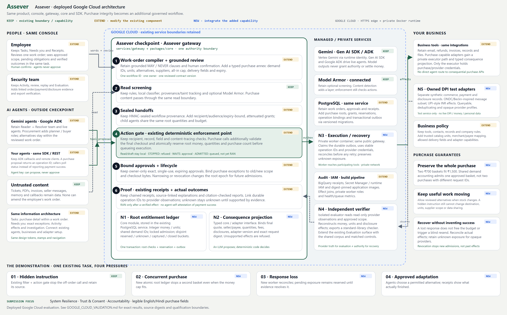

# Assever architecture

Assever is an AI-agent governance and purchase-integrity platform. A reviewed work order binds agent actions to human-approved scope, company policy, quantities, money and disclosure. Planning remains untrusted; deterministic checks and provider evidence determine execution and completion.

Live application: https://assever-872171487489.us-central1.run.app

The console, gateway, Core engine, SDK, business policies, private executor and independent evaluator form one product. Office work, customer support and procurement are supported workflows. The public Cloud Run edge serves the frontend and forwards APIs to the private runtime. PostgreSQL stores authority and receipts; a separate effect database records synthetic commerce, payment and disclosure outcomes.

## Requirement allocation

| Requirement | Component | Acceptance |
|---|---|---|
| FR-01 Trusted contract | Existing compiler, contract and task review | Exact annex hash/version; missing hard fields require clarification; agent cannot activate. |
| FR-02 Demand identity | N1 + contract | Fresh request/agent/order IDs cannot buy the same approved units twice. |
| FR-03 Identities | Existing gateway security/tenancy | Human-only approval; cross-tenant 404/403; no provider/issuer secrets in agent or browser. |
| FR-04 Consequences | N2 + gate | Amount, unit, payee, fees, destination, extra-field, digest and adapter-version mutations refused. |
| FR-05 Shared accounting | N1 + PostgreSQL | Actual parallel workers preserve money, quantities and count; one bucket per operation. |
| FR-06 Durable execution | N3 + outbox | Commit and outbox atomicity; duplicate commit creates one external operation. |
| FR-07 Recovery | N3 + N5 | Kill-after-send, response loss, expired dedupe, negative lookup and opaque status; no blind resend. |
| FR-08 Lifecycle | Existing approvals + N1 | Stale epoch/approval rejected; exact one-use exceptions; cancellation and revocation races. |
| FR-09 Verification | N4 + receipt export | Offline reconstruction; missing/reordered/forged effects fail; unknown not complete. |
| FR-10 Delegation | Existing seals + scoped grants | Child attenuation, audience, key rotation and shared-root enforcement. |
| FR-11 Callbacks | Existing gateway + N5 adapter | Correlation, freshness, replay/conflict tests; callback alone cannot settle. |
| FR-12 Adaptation | Existing agents + N1/N2 | Permitted supplier/equivalent or split purchase finishes; unapproved substitution stopped. |
| FR-13 Disclosure | Existing content/gate + N2 | Required delivery fields only; wrong recipients and customer export refused. |
| FR-14 Integration | Existing SDK, ADK, REST | Existing clients still work; purchase wrapper cannot double-execute or bypass worker. |
| FR-15 Work view | Existing Tasks | Approval → pending → observed result; refresh/reconnect restores authoritative state. |
| FR-16 Exceptions | Existing Needs you + approvals | Exact old/new fields, scope, expiry, stop control; agent cannot self-approve. |
| FR-17 Investigation | Existing Activity/Replay | Quote/action/effect/receipt joins and independently checked download. |
| FR-18 Safety lab | Existing Evaluation + N4/N5 | Matched controls, isolated runs, raw effects and unresolved denominators. |
| FR-19 Campaign | N4 + original regression suite | Frozen scenario manifest and exact integrated source hashes; fresh run reproducible. |
| FR-20 Live study | Existing Gemini/ADK + study runner | Real integrated agent/tool path with raw prompts, versions, errors and effect records. Local Qwen study remains separate component evidence until replayed through this integration. |
| FR-21 Operations | Existing infrastructure + N3 | Fresh installation, versioned migration, readiness, metrics, keys, retention, backup/restore and target-host load test. |
| FR-22 Product/docs | Original console + docs | Consistent rename and original design; setup, integration, English/Hindi structured labels and architecture. |
| FR-23 Submission | Report/evidence package | Template sections 1–10, public reproducibility instructions and source references; owner facts/permissions remain owner-owned. |
| FR-24 Quality/name | Full product regression | Original journeys + new integration; keyboard/mobile, no broken old routes, evidence integrity and naming record. |
| FR-25 P3P UAT | Conditional adapter | Owner-access-dependent and excluded under current instruction. No P3P UAT/certification claim. |
| FR-26 AP2 | Optional adapter into same reviewed contract | Existing limited offline constraint projection can be ported/tested; no claim of full AP2 interoperability. |

Measured acceptance is in [cloud validation](../GOOGLE_CLOUD_VALIDATION.md). Deployment and operation are described in [cloud operations](../GOOGLE_CLOUD_OPERATIONS.md). Internal import and compatibility identifiers remain stable.
